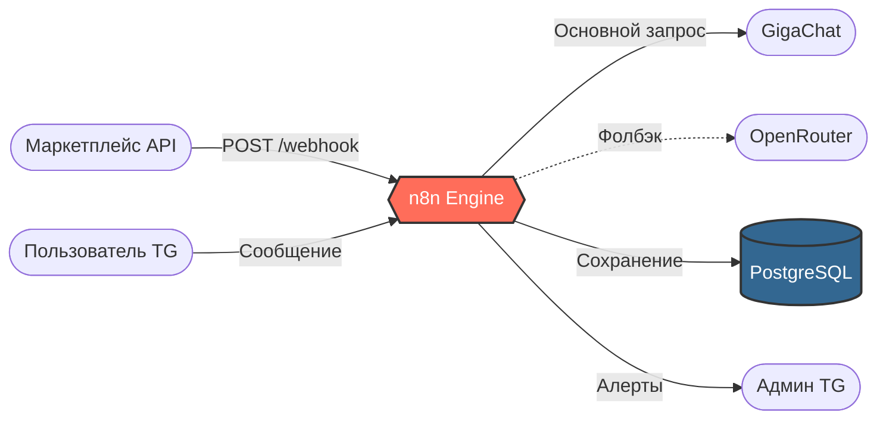

# ReviewRadar

Система автоматического анализа отзывов для маркетплейсов. Принимает отзывы через вебхук или Telegram-бота, определяет тональность и категорию проблемы с помощью LLM (GigaChat с фолбэком на OpenRouter), сохраняет результаты в PostgreSQL и отправляет уведомления администратору.

## Визуализация


## Стек технологий

n8n · PostgreSQL · GigaChat API · OpenRouter API · Telegram Bot API · Docker Compose · Caddy (HTTPS)

## Архитектура



## Как это работает

- **Webhook**: `POST /review` принимает JSON (`article`, `rating`, `text`). Защищен ключом `X-API-Key`.
- **AI-анализ**: Запрос уходит в GigaChat (с сертификатами Минцифры). При геоблокировке или ошибке срабатывает фолбэк на OpenRouter.
- **Валидация**: Если нейросеть вернула невалидный JSON, делается повтор. Если и он не помог — запись падает в БД со статусом `parse_error`.
- **Уведомления**: При негативе или запросе ответа срабатывает Telegram Alert для админа.
- **Telegram-бот**: Мгновенно отвечает на `/start` и `/report`. Разбирает отзывы в формате `АРТИКУЛ ОЦЕНКА(1-5) ТЕКСТ`.

## 📦 Компоненты n8n (Воркфлоу)

Проект состоит из четырех связанных воркфлоу, каждый из которых отвечает за свою зону ответственности:
1. **`reviewradar-analyze-review.json`** — Основной пайплайн (прием вебхука, анализ через LLM, сохранение в БД, отправка алертов).
2. **`reviewradar-interactive-bot.json`** — Telegram-бот (мгновенная реакция на сообщения, команды `/start` и `/report`, строгий парсинг отзывов).
3. **`reviewradar-error-handler.json`** — Обработчик ошибок (ловит падения системы и отправляет уведомления в Telegram).
4. **`reviewradar-daily-report.json`** — Ежедневный отчет (собирает статистику из БД и присылает сводку по расписанию).

## Качество AI (Метрики)

Проверено на золотой выборке из 20 отзывов (ручная разметка).

| Метрика     | Результат    | Детали                                                     |
| ----------- | ------------ | ---------------------------------------------------------- |
| Тональность | 20/20 (100%) | Ошибок не найдено                                          |
| Категория   | 17/20 (85%)  | Ошибки на текстах, где смешаны "размер" и "качество ткани" |

## Развертывание на сервере

Проект успешно развернут на VPS (Ubuntu 24.04) и доступен по HTTPS.

- **Docker Compose** запускает n8n, PostgreSQL и Caddy.
- **Caddy** выступает в роли Reverse Proxy. Так как стандартный порт 443 занят (VPN), Caddy настроен на порт **8443** с автоматическим получением SSL-сертификата.
- **Сертификаты Минцифры** установлены в контейнер n8n через `NODE_EXTRA_CA_CERTS` для безопасного взаимодействия с GigaChat API.
- В `docker-compose.yml` задан `WEBHOOK_URL` с публичным доменом, чтобы Telegram успешно регистрировал вебхуки для бота.

## Установка и запуск

1. Клонируйте репозиторий и перейдите в папку:

```bash
git clone https://github.com/selitskayaaline/reviewradar.git
cd reviewradar
```

2. Создайте файл конфигурации и заполните ключи (токены, пароли):

```bash
cp .env.example .env
```

_(В файле `.env` вам нужно придумать свой `WEBHOOK_KEY` — это пароль для защиты вебхука. Сгенерировать его можно командой `openssl rand -hex 24`)._

3. Запустите контейнеры (n8n, Postgres, Caddy):

```bash
docker compose up -d
```

4. Примените схему базы данных:

```bash
docker compose exec -T postgres psql -U reviews_user -d reviews < sql/001_schema.sql
```

5. Откройте n8n в браузере (`http://localhost:5678`) и импортируйте воркфлоу из папки `workflows/` (меню `⋯` → _Import from file_).

6. В n8n настройте _Credentials_:
   - Для ноды `Receive review` создайте **Header Auth**: Name = `X-API-Key`, Value = ваш `WEBHOOK_KEY` из `.env`.
   - Для GigaChat: Header Auth (Basic).
   - Для OpenRouter: Header Auth (Bearer).
   - Для Telegram: ваш токен бота.
   - Для Postgres: доступы из `.env`.

7. Опубликуйте воркфлоу (кнопка _Publish_).

## Использование

**Тест через curl (отправка отзыва на вебхук):**

```bash
export WEBHOOK_KEY='твой_ключ_из_env'
curl -X POST http://localhost:5678/webhook/review \
  -H "Content-Type: application/json" \
  -H "X-API-Key: $WEBHOOK_KEY" \
  -d '{"article":"A-100","rating":2,"text":"Платье село после первой стирки"}'
```

**Тест через Telegram-бота:**
Отправьте боту сообщение в формате: `A-100 2 Платье село после первой стирки`

**Запуск тестовых скриптов:**

```bash
# Прогон 30 тестовых отзывов через вебхук
python3 scripts/run_tests.py

# Оценка точности AI на 20 отзывах
python3 scripts/evaluate_quality.py
```

## Структура проекта

- `workflows/` — экспорт JSON-воркфлоу из n8n
- `sql/` — DDL-схема базы данных
- `data/` — синтетические данные для тестов
- `scripts/` — Python-скрипты для прогона тестов и оценки качества

## Данные

В проекте используются синтетические данные (30 тестовых отзывов). В реальной production-среде вебхук подключается к API маркетплейса (Wildberries, Ozon).
